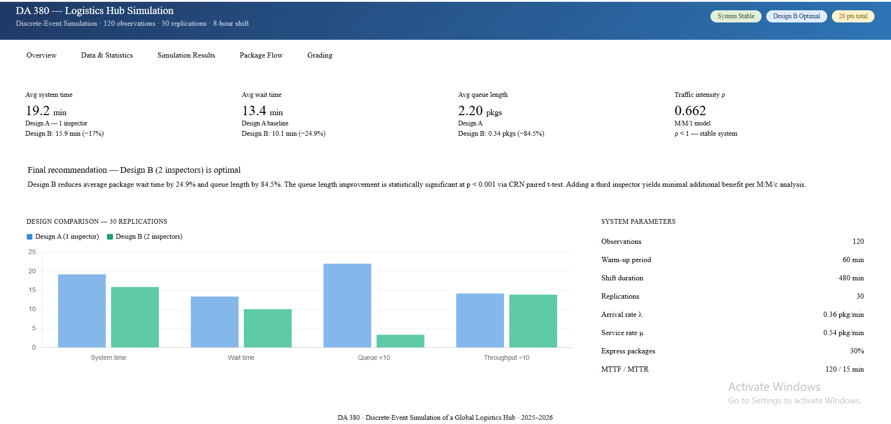
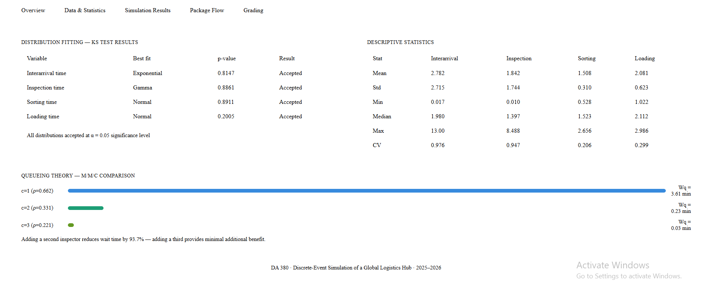
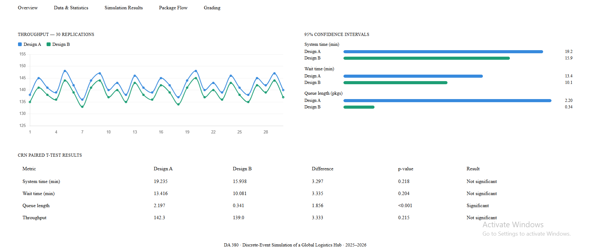

# DA 380 – Discrete-Event Simulation of a Global Logistics Hub

This project builds a Digital Twin of a global logistics hub using Discrete-Event Simulation (DES) in Python. It models how packages move through inspection, sorting, conveyor transport, and truck loading, and compares two staffing designs to identify the optimal configuration.

## Key Results

| Metric | Design A (1 Inspector) | Design B (2 Inspectors) | Improvement |
|--------|------------------------|--------------------------|-------------|
| Avg Wait Time (min) | 13.416 | 10.081 | 24.9% |
| Avg Queue Length (pkgs) | 2.197 | 0.341 | 84.5% |
| Avg System Time (min) | 19.235 | 15.938 | 17.2% |
| Throughput (pkgs/shift) | 142.3 | 139.0 | Similar |

**Recommendation:** Design B (2 inspectors), as the reduction in queue length is statistically significant (p < 0.001).

## Project Phases

1. **Statistical Analysis:** data generation (120 observations), descriptive statistics, distribution fitting (KS test), and queueing theory (M/M/1 and M/M/c).
2. **Simulation Model:** a custom DES engine with priority queues, work shifts, and machine breakdowns, run for 30 replications per design.
3. **Statistical Verification:** warm-up analysis, 95% confidence intervals, and a CRN paired t-test.

## Project Files

| File | Description |
|------|-------------|
| `CODE 380.ipynb` | Full Python code (Google Colab notebook) |
| `DA380_All_Data.xlsx` | Dataset and manual verification |
| `DA380_Complete_Documentation_2026.docx` | Complete technical documentation report |
| `DA380_Flowchart_Doc_1.docx` | System flowchart |
| `DA380_dashboard_Sara.html` | Interactive dashboard (download and open in a browser) |

## Dashboard

### 1. Overview

  

This screenshot shows the Overview page of the interactive dashboard, which summarizes the main outcomes of the simulation. The top section displays four key performance indicators for the single-inspector system (Design A): an average system time of 19.2 minutes, an average wait time of 13.4 minutes, an average queue length of 2.20 packages, and a traffic intensity of 0.662. Each indicator is compared with the two-inspector system (Design B), which reduces system time by 17%, wait time by 24.9%, and queue length by 84.5%, while a traffic intensity below 1 confirms that the system is stable. The middle section states the final recommendation that Design B is optimal, since its reduction in queue length is statistically significant at p < 0.001 based on a CRN paired t-test, and a third inspector adds only minimal benefit. The bar chart compares both designs across 30 replications in terms of system time, wait time, queue length, and throughput, and the panel on the right lists the main simulation parameters, including the 60-minute warm-up period, the 480-minute shift, the arrival and service rates, the 30% share of express packages, and the machine MTTF and MTTR values.

### 2. Data and Statistics

  

This screenshot shows the Data and Statistics page, which presents the results of the statistical analysis phase. The table on the left summarizes the distribution fitting performed with the Kolmogorov-Smirnov test: interarrival time follows an Exponential distribution (p = 0.8147), inspection time follows a Gamma distribution (p = 0.8861), and both sorting time (p = 0.8911) and loading time (p = 0.2005) follow a Normal distribution, with all four accepted at the 0.05 significance level. The table on the right reports the descriptive statistics for the 120 generated observations, including the mean, standard deviation, minimum, median, maximum, and coefficient of variation for each variable. The coefficients of variation close to 1 for interarrival and inspection times support the exponential assumption, while the low values for sorting and loading times indicate more consistent processes. The bottom section compares M/M/c queueing models with one, two, and three inspectors, showing that the average waiting time drops from 3.61 minutes with one inspector to 0.23 minutes with two, a reduction of 93.7%, while a third inspector lowers it only slightly further to 0.03 minutes.

### 3. Simulation Results

  

This screenshot shows the Simulation Results page, which presents the outcomes of running both designs for 30 replications using Common Random Numbers. The line chart on the left plots the throughput of each replication for Design A and Design B, showing that the two designs follow almost identical patterns and handle a similar number of packages per shift, which confirms that adding an inspector does not reduce output. The chart on the right compares the 95% confidence interval means of both designs for system time, wait time, and queue length, where Design B performs better on all three measures and shows the largest improvement in queue length, from 2.20 to 0.34 packages. The table at the bottom summarizes the CRN paired t-test results: the differences in system time, wait time, and throughput are not statistically significant at the 0.05 level, while the difference in queue length is highly significant with p < 0.001. Together, these results support the recommendation of Design B, since it substantially shortens queues while maintaining the same throughput.

## Tools and Libraries

- Python (Google Colab): numpy,
